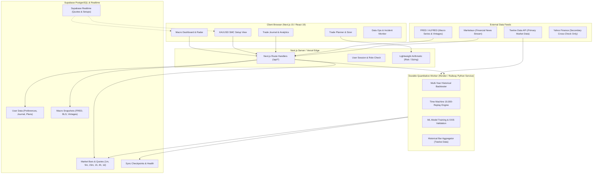

# Target Architecture & Infrastructure Design (Phase 1 — Read-Only)

**System:** MacroEdge Institutional Terminal × Day Trading Strategy System  
**Auditor Role:** Senior Quantitative Trading Software Engineer & Full-Stack Architect  

---

## 1. System Components & Responsibility Matrix

---

## 2. Durable Worker Options Comparison & Recommendation

| Worker Option | Execution Model | Max Duration | Memory Limits | Cold-Start Overhead | Python ML / Vector Support | Verdict & Recommendation |
|---|---|---|---|---|---|---|
| **Vercel Serverless Functions** | Ephemeral Request / Serverless | 10s (Hobby) / 60s (Pro) | 1,024 MB – 3,008 MB | Moderate (200ms–1.5s) | Limited (Python runtime lacks heavy scientific wheel caching) | **REJECTED**: Cannot run 10,000-session Monte Carlo simulations or multi-year bar backtests without fatal timeouts. |
| **Vercel Cron / Scheduled Tasks** | Scheduled webhook trigger | 60s max | Standard function limits | Moderate | Node.js primary | **REJECTED for Compute**: Suitable only for lightweight sync pings (`/api/sync/cron`), not heavy quantitative jobs. |
| **Inngest (Serverless Orchestrator)** | Step-function execution over serverless | Steps limited to function timeout | Bound to Vercel memory | Low | Node.js native; Python SDK exists but runs on user infra | **VIABLE FOR ORCHESTRATION**, but requires underlying compute for scientific Python packages (NumPy, SciPy, Pandas). |
| **Trigger.dev (v3)** | Serverless containerized background tasks | Up to several hours | Up to 8 GB | Low to moderate | Strong Node/TS support; Python support requires custom Docker container | **VIABLE ALTERNATIVE**, but adds vendor complexity and billed compute minutes. |
| **Dedicated Python Worker (Render / Railway Container)** | Continuous background daemon / Docker container | **Unlimited** (continuous) | 2 GB – 16 GB dedicated | **Zero** (always warm) | **Native / Optimal**: PyTorch, XGBoost, Pandas, NumPy already configured | **RECOMMENDED**: Zero-timeout capability, predictable cost, dedicated CPU for simulations, seamless integration with existing `render.yaml` and `ml/` environment. |

### Technical Justification for Dedicated Python Worker:
1. **Timeout Immunity:** A 5-year 1-minute bar backtest of XAUUSD involves over 1.8 million rows. Calculating rolling fractal swing highs, unmitigated order blocks, and multi-timeframe liquidity sweeps takes 30–90 seconds of vectorised compute—impossible within Vercel's 10–60s boundary.
2. **Memory Stability:** Running 10,000 Monte Carlo path draws requires dedicated RAM without serverless garbage-collection thrashing.
3. **Environment Synergy:** The repository already possesses `render.yaml` and an existing `.venv` containing verified Python dependencies (`scikit-learn`, `xgboost`, `pandas`, `numpy`).

---

## 3. Work Placement Matrix

| Task / Computation | Placement | Trigger / Cadence | Latency Target |
|---|---|---|---|
| **User Preferences & Watchlist Management** | Next.js Server Action / API Route | User interaction | < 100 ms |
| **Position Sizing & Risk Arithmetic** | Client-Side / Edge Next.js | Instant on input change | < 5 ms |
| **1D/4H Macro Bias Evaluation** | Edge Next.js API (`/api/macro/bias`) | Reads latest pre-computed artifact | < 50 ms |
| **15M / 5M / 1M Live Setup Detection** | Server-Side Worker / Route Poller | Bar-close event (1m, 5m, 15m) | < 500 ms |
| **Time Machine 10k Path Simulation** | Durable Python Worker (`POST /simulate`) | On-demand user scenario request | 2 – 5 seconds |
| **Historical Multi-Year Backtest** | Durable Python Worker (`POST /backtest`) | Background queue / Job status polling | 15 – 60 seconds |
| **Market Data Synchronization (Twelve Data)** | Scheduled Worker / Durable Daemon | Cadence aligned to Twelve Data 8 rpm tier | Every 7.5 seconds |
| **Macro Data Vintage Ingestion (FRED/BLS)** | Next.js Vercel Cron (`/api/sync/cron`) | Every 5 minutes (`*/5 * * * *`) | Background |

---

## 4. Security Boundaries & Credential Isolation

1. **Client Isolation:**
   - Client code only receives `NEXT_PUBLIC_SUPABASE_URL` and `NEXT_PUBLIC_SUPABASE_ANON_KEY`.
   - Never expose API keys for Twelve Data, FRED, BLS, BEA, Marketaux, or Alpaca to browser bundles.
2. **Server-Role Isolation:**
   - `SUPABASE_SERVICE_ROLE_KEY` is loaded strictly on the server in `src/lib/supabase/admin.ts`.
   - Any attempt to import or execute `getSupabaseAdminClient()` in a browser context throws an immediate runtime exception (`schema.sql#L34`).
3. **Internal Microservice Network Security:**
   - Communications between Next.js and the Durable Python Worker are secured via an internal pre-shared key header (`X-MacroEdge-Worker-Token`).
   - If deployed on Render or private networks, communications route via private service discovery URLs (`http://ml-service:8000`), completely bypassing the public internet.

---

## 5. Observability, Telemetry & Incident Response

1. **Structured Logging:**
   - All serverless and worker executions emit structured JSON logs with correlation IDs (`trace_id`, `user_id`, `instrument`, `timeframe`).
2. **Job State Machine:**
   - Background backtests and simulations write state to `public.sync_runs` and `public.backtest_runs` with explicit statuses: `QUEUED`, `RUNNING`, `SUCCEEDED`, `FAILED`, `CANCELLED`.
3. **Circuit Breakers & Alerts:**
   - Twelve Data rate-limit monitor (`market-engine.ts#L946`) enforces a 7,500ms spacing and 8 calls/min ceiling. If rate limits are approached, worker automatically pauses requests and emits a `RATE_LIMIT_WARNING` incident.
   - If a data provider feed becomes stale or unresponsive, the Autonomous Incident Engine (`src/services/incidents/debugger-engine.ts`) captures the stack trace, redacts credentials, and logs an incident in `system_incidents`.
